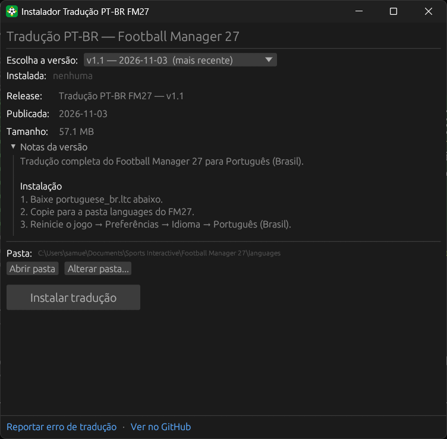

<p align="center">
  
</p>

<h1 align="center">FM27 Translator Installer</h1>

<p align="center">
  <b>English</b> · <a href="README.pt-BR.md">Português (Brasil)</a>
</p>

<p align="center">
  A small desktop app that installs the <a href="https://github.com/arthurabreu/fm27-ptbr-release">Brazilian Portuguese translation</a> of Football Manager 27 in one click. Works with the Steam and Epic Games versions.
</p>

<p align="center">
  
  
  
  
  
</p>

<p align="center">
  <a href="https://github.com/SamuelSchutz13/FM27-Translator-Installer/releases/latest/download/FM27-Translator-Installer.exe"><b>Download FM27-Translator-Installer.exe</b></a>
</p>

<p align="center">
  
</p>

> [!NOTE]
> **It only talks to GitHub.** The app reads the release list from the GitHub API and downloads `portuguese_br.ltc` from the release you choose. It does not touch the game's executables or files: it only drops the translation file into the `languages` folder.

## Features

- **Version picker**: every release of the translation, newest first. The latest stable one is selected and marked **(mais recente)**; pre-releases are marked too.
- **Installed version** with an **update available** hint when a newer release is out.
- **Release notes** of the selected version, straight from GitHub.
- **Install** with a progress bar. The file is written to a temporary name and then swapped in, so an interrupted download never breaks the translation already installed.
- **Uninstall** (asks for confirmation) removes the translation file.
- **Open folder** shows the `languages` folder in Explorer; **Change folder...** lets you pick the game folder by hand, and the choice is remembered.
- **Game running warning**: checks every 2 seconds whether FM27 is open, since the game only loads translations on start.
- Links to **report a translation error** and to the translation repository.
- Its own icon, no console window, and the C runtime built in, so it runs on a clean Windows install.

## Getting started

### Using it

1. Open Football Manager 27 at least once, so the game creates its folder in Documents.
2. Download **[FM27-Translator-Installer.exe](https://github.com/SamuelSchutz13/FM27-Translator-Installer/releases/latest/download/FM27-Translator-Installer.exe)** and open it.
3. Pick a version and click **Instalar tradução**.
4. Restart FM27 and go to **Preferences → Language → "Português (Brasil)"**.

> [!TIP]
> Windows SmartScreen may warn that the app is unrecognized, because the `.exe` is not code signed. Click **More info → Run anyway**.

### Building from source

Needs [Rust](https://rustup.rs) (stable).

```sh
git clone https://github.com/SamuelSchutz13/FM27-Translator-Installer.git
cd FM27-Translator-Installer

cargo run --release   # or: cargo test
```

The executable lands in `target/release/fm27-translator-installer.exe`.

## How it works

```
api.github.com/repos/arthurabreu/fm27-ptbr-release/releases  →  version picker + notes
release asset portuguese_br.ltc  →  portuguese_br.ltc.tmp  →  rename  →  languages/portuguese_br.ltc
```

- **Game folder**: Steam and Epic both use `Documents\Sports Interactive\Football Manager 27\languages`. The Documents folder is resolved through Windows, so a Documents folder moved to OneDrive works too. Linux (Steam/Proton) and macOS paths follow the translation's README.
- **Installed version** and the **custom folder** are stored in `%APPDATA%\fm27-translator-installer\`, never inside the game folder.
- **Game running**: looks for the `fm.exe` process with `tasklist`, without flashing a console.

### Project structure

```
src/main.rs           the whole app: GitHub releases, download, install, and the egui window
build.rs              embeds the icon into the .exe
assets/
  icon.png            window icon
  icon.ico            .exe icon
.cargo/config.toml    builds with the C runtime built in (no Visual C++ Redistributable needed)
.github/assets/       README screenshot
```

## Known limitations

- **Game detection assumes `fm.exe`**, the executable name of previous Football Manager games. If FM27 ships with another name, the warning will not show.
- Without a GitHub login, the API allows about 60 requests per hour per network. Each time the app opens counts as one request, which is plenty for normal use.
- The version picker lists the 30 most recent releases.
- The `.exe` is not code signed, so SmartScreen may warn on first run.

## Credits

- Translation: [arthurabreu/fm27-ptbr-release](https://github.com/arthurabreu/fm27-ptbr-release), made by the community. Report translation errors in [its issues](https://github.com/arthurabreu/fm27-ptbr-release/issues).
- GUI: [egui / eframe](https://github.com/emilk/egui). Folder picker: [rfd](https://github.com/PolyMeilex/rfd).
- Icon made for this project.
- Football Manager is a trademark of Sports Interactive / SEGA. This project is not affiliated with them.
