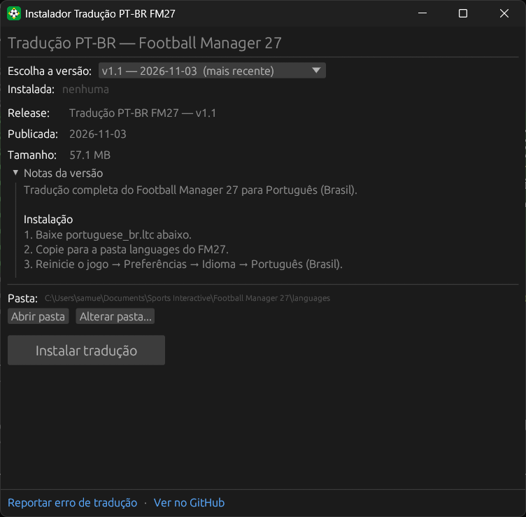

<p align="center">
  
</p>

<h1 align="center">FM27 Translator Installer</h1>

<p align="center">
  <a href="README.md">English</a> · <b>Português (Brasil)</b>
</p>

<p align="center">
  Um app de desktop pequeno que instala a <a href="https://github.com/arthurabreu/fm27-ptbr-release">tradução PT-BR</a> do Football Manager 27 com um clique. Funciona com a versão da Steam e da Epic Games.
</p>

<p align="center">
  
  
  
  
  
</p>

<p align="center">
  <a href="https://github.com/SamuelSchutz13/FM27-Translator-Installer/releases/latest/download/FM27-Translator-Installer.exe"><b>Baixar FM27-Translator-Installer.exe</b></a>
</p>

<p align="center">
  
</p>

> [!NOTE]
> **Ele só conversa com o GitHub.** O app lê a lista de releases pela API do GitHub e baixa o `portuguese_br.ltc` da release que você escolher. Ele não mexe nos executáveis nem nos arquivos do jogo: só coloca o arquivo de tradução na pasta `languages`.

## Funcionalidades

- **Seletor de versão**: todas as releases da tradução, da mais nova para a mais antiga. A última estável já vem escolhida e marcada como **(mais recente)**; pré-releases também aparecem marcadas.
- **Versão instalada**, com o aviso de **atualização disponível** quando sai uma release nova.
- **Notas da versão** escolhida, direto do GitHub.
- **Instalar** com barra de progresso. O arquivo é gravado com um nome temporário e só depois substitui o antigo, então um download interrompido nunca estraga a tradução que já estava instalada.
- **Desinstalar** (pede confirmação) remove o arquivo de tradução.
- **Abrir pasta** mostra a pasta `languages` no Explorer; **Alterar pasta...** deixa você escolher a pasta do jogo na mão, e a escolha fica salva.
- **Aviso de jogo aberto**: confere a cada 2 segundos se o FM27 está rodando, já que o jogo só carrega traduções ao iniciar.
- Links para **reportar erro de tradução** e para o repositório da tradução.
- Ícone próprio, sem janela de console e com o runtime do C embutido, então roda num Windows recém-instalado.

## Como usar

### Usando

1. Abra o Football Manager 27 pelo menos uma vez, para o jogo criar a pasta dele em Documentos.
2. Baixe o **[FM27-Translator-Installer.exe](https://github.com/SamuelSchutz13/FM27-Translator-Installer/releases/latest/download/FM27-Translator-Installer.exe)** e abra.
3. Escolha a versão e clique em **Instalar tradução**.
4. Reinicie o FM27 e vá em **Preferências → Idioma → "Português (Brasil)"**.

> [!TIP]
> O SmartScreen do Windows pode avisar que o app não é reconhecido, porque o `.exe` não tem assinatura digital. Clique em **Mais informações → Executar assim mesmo**.

### Compilando o código

Precisa do [Rust](https://rustup.rs) (stable).

```sh
git clone https://github.com/SamuelSchutz13/FM27-Translator-Installer.git
cd FM27-Translator-Installer

cargo run --release   # ou: cargo test
```

O executável fica em `target/release/fm27-translator-installer.exe`.

## Como funciona

```
api.github.com/repos/arthurabreu/fm27-ptbr-release/releases  →  seletor de versão + notas
arquivo portuguese_br.ltc da release  →  portuguese_br.ltc.tmp  →  renomeia  →  languages/portuguese_br.ltc
```

- **Pasta do jogo**: Steam e Epic usam a mesma `Documentos\Sports Interactive\Football Manager 27\languages`. A pasta Documentos vem do próprio Windows, então funciona mesmo se ela estiver no OneDrive. Os caminhos de Linux (Steam/Proton) e macOS seguem o README da tradução.
- **Versão instalada** e **pasta escolhida** ficam em `%APPDATA%\fm27-translator-installer\`, nunca dentro da pasta do jogo.
- **Jogo aberto**: procura o processo `fm.exe` com o `tasklist`, sem piscar console.

### Estrutura do projeto

```
src/main.rs           o app inteiro: releases do GitHub, download, instalação e a janela egui
build.rs              embute o ícone no .exe
assets/
  icon.png            ícone da janela
  icon.ico            ícone do .exe
.cargo/config.toml    compila com o runtime do C embutido (não precisa do Visual C++ Redistributable)
.github/assets/       print do README
```

## Limitações conhecidas

- **A detecção do jogo procura `fm.exe`**, o nome do executável dos Football Manager anteriores. Se o FM27 usar outro nome, o aviso não aparece.
- Sem login no GitHub, a API permite umas 60 consultas por hora por internet. Cada vez que o app abre conta uma, o que é mais que suficiente.
- O seletor lista as 30 releases mais recentes.
- O `.exe` não tem assinatura digital, então o SmartScreen pode avisar na primeira vez.

## Créditos

- Tradução: [arthurabreu/fm27-ptbr-release](https://github.com/arthurabreu/fm27-ptbr-release), feita pela comunidade. Reporte erros de tradução nas [issues de lá](https://github.com/arthurabreu/fm27-ptbr-release/issues).
- Interface: [egui / eframe](https://github.com/emilk/egui). Seletor de pastas: [rfd](https://github.com/PolyMeilex/rfd).
- Ícone feito para este projeto.
- Football Manager é marca da Sports Interactive / SEGA. Este projeto não tem ligação com elas.
